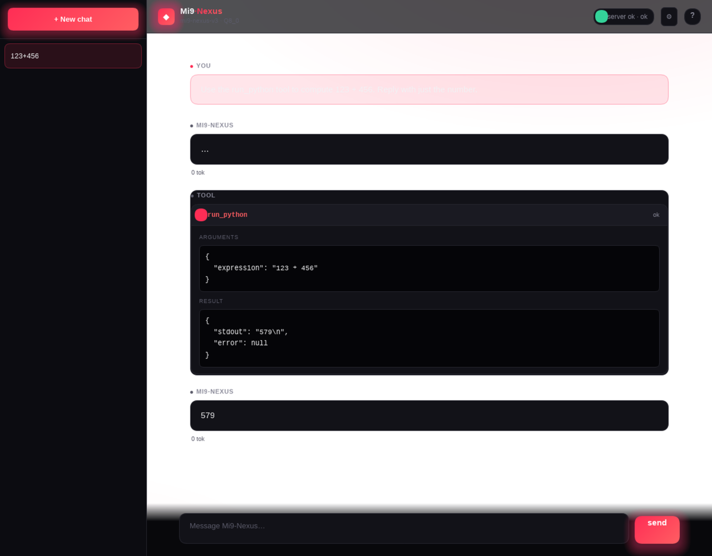

# Mi9-Nexus

**A small, local AI that runs on ordinary hardware — no GPU, no internet required.**

Mi9-Nexus is a 1.7-billion-parameter model paired with a lightweight agent harness.
It can write and run code, do arithmetic, search the web, and read documents — and it
shows its work by actually executing each step instead of guessing.



---

## What it is

- **Small by design.** A 1.7B model (Qwen3-1.7B + a fine-tune of our own), quantized to
  8-bit — about **1.83 GB**. It fits in the RAM of an ordinary laptop.
- **A harness, not just a model.** The model acts as a controller. It decides when to use a
  tool, runs it, and answers from the real result:
  - `run_python` — sandboxed Python for arithmetic and logic
  - `web_search` / `web_fetch` — live web, with citations
  - `retrieve` — search a local document corpus
  - `office_read` — pull text out of `.docx`, `.pptx`, `.xlsx`
- **Runs everywhere.** A Linux desktop app (Tauri) and an Android app (native llama.cpp +
  a PRoot/Alpine sandbox), sharing one web interface.
- **Measured, not marketed.** On our regression suite it scores **86%** overall
  (code 100%, math 68%, logic 58%) at ~16.5 tokens/second on CPU.

---

## How the model was improved

We started from a stock 1.7B model and improved it with a simple, repeatable loop:

1. **Attempt → verify → keep.** The model tries tasks (code, math, logic). A verifier
   checks each attempt, and only the wins are kept.
2. **Train on the wins.** A small LoRA adapter fine-tunes on those verified examples, then
   is merged back into the base. The change only ships if a regression gate confirms it
   didn't make the model worse.

Three lessons did most of the work:

- **Format matters more than data volume.** Training on prose-style traces ("step 1, step 2")
  collapsed code ability from **73% → 22%**. Same weights, different format.
- **Narrow data causes forgetting.** Training on a thin slice (only math, or only tool calls)
  improved that slice and degraded everything else — so every update has to stay balanced.
- **Compression was quietly hurting it.** Serving at 4-bit was losing ~16 points. Moving the
  *same* model to 8-bit took it from **70% → 86%**.

Finally, we hit the honest ceiling of a 1.7B model's weights — and shifted effort to the
**harness**. Letting the model try several answers and keep the one that verifies
(**test-time compute**) raised code/text accuracy from **58% → 83%**. The lesson: for small
models, the leverage is the scaffolding around the model, not a bigger model.

---

## What this makes possible

A model this size isn't frontier — but that's the point. Small, local, and verifiable opens
up use cases that big cloud models can't serve well:

- **Private by default.** Your documents, notes, and code never leave the device. Useful for
  sensitive, regulated, or personal work.
- **Offline / low-connectivity.** Runs with no internet — field work, travel, labs, rural or
  bandwidth-limited settings.
- **A coding and math helper that shows its work.** It runs code in a sandbox and reports the
  real output, so you can check it.
- **Document assistant.** Read, summarize, and query `.docx` / `.pptx` / `.xlsx` files locally.
- **On-device and edge AI.** A base you can actually run on a laptop or phone — for
  education, experimentation, and building specialized local agents.

In short: **smaller, but more useful** — intelligence and knowledge separated, with the
harness doing the heavy lifting.

---

## Quick start

```sh
# 1. model server (llama.cpp) on :8080
cd mi9-ai-model && nexus/serve

# 2. tool server on :8090
cd mi9-ai-model && .venv/bin/python -m nexus.toolserver

# 3. web UI on :3000  ->  open http://localhost:3000
cd nexus-web && node server.js
```

Model weights download on first run by the desktop/Android apps, or directly from the
[public mirror](https://pub-d33de59ed2ce4360adf02fc3e0cd87d6.r2.dev/mi9-nexus-v3-Q8_0.gguf).

## Layout

| Path | What it is |
|------|------------|
| `mi9-ai-model/` | Training/growth loop, agent loop, tool server, eval suites, corpus, reports. |
| `nexus-web/` | The web UI (zero-dependency Node server + single-page app). |
| `nexus-desktop/` | Desktop app (Tauri 2.0 / Rust) bundling llama.cpp + the webapp. |
| `nexus-android/` | Android app (Kotlin) — native llama.cpp + PRoot/Alpine sandbox. |
| `docs/` | Screenshots. |

## License — source-available, non-commercial

Licensed under the **PolyForm Noncommercial License 1.0.0** (see [`LICENSE`](LICENSE)).

- You may **read, use, modify, and share** the code for **non-commercial** purposes.
- **Commercial use is not permitted** without a separate license. To discuss one, contact
  `angshu.roy.1910@gmail.com`.

> Required Notice: Copyright 2026 anb-labs (https://github.com/anb-labs).

**Forks are not officially recognized or endorsed by anb-labs.** The license grants the
rights above for non-commercial use; we don't review, support, or claim any fork.

## What is not in this repo

To keep it source-only, these are excluded and must be fetched or built:

- **Model weights** (`mi9-ai-model/models/`) — fetch from the public mirror above.
- **LoRA adapters** (`mi9-ai-model/adapters/`) — training outputs.
- **Android `third_party/llama.cpp`** — clone llama.cpp there (a build dependency).
- **Desktop llama-server sidecar** and Rust `target/`.
- **Signing keys and secrets** (`credentials/`, `*.keystore`, `keystore.properties`) — never included.